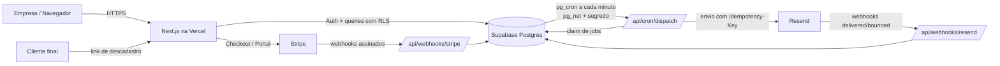
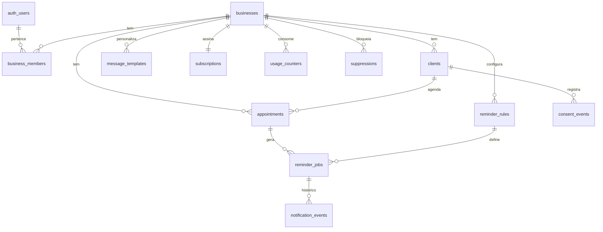

# Plano Técnico — Micro-SaaS de Agendamentos e Lembretes Automáticos

> Fase 1: Arquitetura e Planejamento. Nenhum código de aplicação foi escrito ainda.
> Este documento é a base para as próximas fases e deve ser revisado sempre que uma decisão mudar.
>
> Codinome provisório do produto: **"ReminderApp"** (o nome comercial será definido antes da landing page).
> Data: outubro de 2026.

---

## Sumário

1. [Viabilidade técnica](#1-viabilidade-técnica)
2. [Principais riscos](#2-principais-riscos)
3. [Arquitetura recomendada](#3-arquitetura-recomendada)
4. [Custos mensais estimados](#4-custos-mensais-estimados)
5. [Planos e limites sugeridos](#5-planos-e-limites-sugeridos)
6. [Estrutura de pastas](#6-estrutura-de-pastas)
7. [Modelo do banco de dados](#7-modelo-do-banco-de-dados)
8. [Motor de lembretes (automação)](#8-motor-de-lembretes-automação)
9. [Segurança e conformidade legal (EUA)](#9-segurança-e-conformidade-legal-eua)
10. [Estratégia de testes](#10-estratégia-de-testes)
11. [Escopo do MVP](#11-escopo-do-mvp)
12. [Cronograma (1 hora por dia)](#12-cronograma-1-hora-por-dia)
13. [Primeiro passo prático no Windows](#13-primeiro-passo-prático-no-windows)
14. [Decisões pendentes](#14-decisões-pendentes)

---

## 1. Viabilidade técnica

**Conclusão: o projeto é tecnicamente viável para um iniciante, desde que o escopo do MVP seja mantido enxuto.**

Por quê:

| Necessidade                    | Como é resolvida                                                      | Complexidade |
| ------------------------------ | --------------------------------------------------------------------- | ------------ |
| Autenticação                   | Supabase Auth (pronto, seguro, com e-mail/senha e magic link)         | Baixa        |
| Banco de dados multiempresa    | PostgreSQL do Supabase + Row Level Security (RLS)                     | Média        |
| Interface premium e responsiva | Next.js + Tailwind CSS + shadcn/ui (componentes prontos e acessíveis) | Média        |
| Envio de e-mail                | Resend (API simples, templates em React)                              | Baixa        |
| Tarefas agendadas sem servidor | `pg_cron` do Supabase chamando uma rota protegida a cada minuto       | Média        |
| Pagamentos recorrentes         | Stripe Checkout + Customer Portal + Webhooks                          | Média        |
| Hospedagem                     | Vercel (deploy automático a cada `git push`)                          | Baixa        |

A parte **realmente difícil** não é a interface — é a **confiabilidade dos lembretes** (fusos horários, reenvio, duplicidade) e a **conformidade legal**. Por isso essas partes recebem atenção especial neste plano.

Nenhum servidor precisará ser administrado: todos os serviços são gerenciados ("serverless").

---

## 2. Principais riscos

| #   | Risco                                                                                 | Impacto                                                 | Mitigação                                                                                                                                                                      |
| --- | ------------------------------------------------------------------------------------- | ------------------------------------------------------- | ------------------------------------------------------------------------------------------------------------------------------------------------------------------------------ |
| 1   | **Vazamento de dados entre empresas** (empresa A vê clientes da empresa B)            | Crítico                                                 | RLS em **todas** as tabelas; testes automatizados que tentam acessar dados de outra empresa; chave `service_role` usada apenas em rotas de servidor específicas.               |
| 2   | **Lembretes duplicados, atrasados ou não enviados**                                   | Alto (é o produto)                                      | Fila no banco com estados, travas (`FOR UPDATE SKIP LOCKED`), chave de idempotência única por lembrete, reenvio com backoff, recuperação de travas "presas".                   |
| 3   | **Erros de fuso horário / horário de verão**                                          | Alto                                                    | Armazenar tudo em UTC (`timestamptz`); fuso IANA por empresa (ex.: `America/Chicago`); conversão apenas na exibição; testes específicos para as datas de mudança de horário.   |
| 4   | **Conformidade legal nos EUA** (CAN-SPAM, TCPA para SMS, leis estaduais, privacidade) | Alto (multas de US$ 500–1.500 por SMS indevido no TCPA) | Consentimento registrado por cliente; link de descadastro em todo e-mail; SMS só depois, com opt-in explícito e tratamento de "STOP"; Termos de Uso e Política de Privacidade. |
| 5   | **Entregabilidade de e-mail** (lembretes caindo no spam)                              | Alto                                                    | Domínio próprio com SPF, DKIM e DMARC; conteúdo estritamente transacional; tratamento de bounces e reclamações via webhook.                                                    |
| 6   | **Empresa jurídica e recebimento de pagamentos** (você reside fora dos EUA?)          | Alto                                                    | Definir antes da Fase 7: conta Stripe no Brasil vs. LLC americana (Stripe Atlas) vs. "Merchant of Record". Consultar um contador sobre impostos e _sales tax_ americano.       |
| 7   | **Dados de saúde (HIPAA)** — clínicas podem colocar informações médicas nos lembretes | Alto                                                    | No MVP, **proibir nos Termos de Uso** o uso por entidades cobertas pela HIPAA e evitar campos de texto livre nos templates de saúde. Não focar em clínicas inicialmente.       |
| 8   | **Concorrência** (Calendly, Square Appointments, Setmore, Acuity têm lembretes)       | Médio                                                   | Focar em um nicho (ex.: barbearias, serviços domésticos, personal trainers) e na simplicidade. Validar com 10 conversas com potenciais clientes antes do lançamento.           |
| 9   | **Tempo limitado (1h/dia) e aumento de escopo**                                       | Médio                                                   | MVP rigoroso; cada sessão de 1h termina com algo testado e salvo no Git.                                                                                                       |
| 10  | **Manutenção em produção por um iniciante**                                           | Médio                                                   | Testes automatizados, CI no GitHub, monitoramento de erros (Sentry), backups diários (Supabase Pro), ambientes separados de desenvolvimento e produção.                        |

---

## 3. Arquitetura recomendada

### 3.1 Stack escolhida

| Camada        | Tecnologia                                                         | Justificativa                                                                                                                                                 |
| ------------- | ------------------------------------------------------------------ | ------------------------------------------------------------------------------------------------------------------------------------------------------------- |
| Aplicação     | **Next.js (App Router) + TypeScript (strict)**                     | Front-end e back-end no mesmo projeto; Server Actions e Route Handlers eliminam um servidor separado.                                                         |
| Estilo        | **Tailwind CSS v4 + shadcn/ui**                                    | Componentes prontos, acessíveis e com aparência profissional; o código fica no nosso projeto (sem dependência "caixa-preta").                                 |
| Validação     | **Zod**                                                            | Mesmo schema valida formulários no navegador e no servidor.                                                                                                   |
| Auth + Banco  | **Supabase** (Auth, PostgreSQL, RLS, `pg_cron`, `pg_net`, Vault)   | Um único serviço cobre login, banco, segurança por linha e agendador.                                                                                         |
| E-mail        | **Resend + React Email**                                           | API simples, suporte a chave de idempotência, webhooks de entrega/bounce.                                                                                     |
| Pagamentos    | **Stripe Billing** (Checkout, Customer Portal, Webhooks)           | Upgrades, downgrades, cancelamento e cobrança de cartão já prontos no portal do Stripe.                                                                       |
| Hospedagem    | **Vercel**                                                         | Deploy automático pelo GitHub; ambiente de _preview_ para cada branch.                                                                                        |
| Agendador     | **Supabase `pg_cron` → rota `/api/cron/dispatch` a cada minuto**   | Gratuito, roda no servidor do banco, não depende de navegador aberto. Alternativa: Vercel Cron (exige plano Pro, que usaremos em produção de qualquer forma). |
| Calendário    | **FullCalendar** (ou componente próprio de semana/mês)             | Visualizações de dia/semana/mês prontas e responsivas.                                                                                                        |
| Datas         | **date-fns + date-fns-tz**                                         | Conversão confiável entre UTC e fuso da empresa.                                                                                                              |
| Monitoramento | **Sentry** (plano gratuito) + logs estruturados                    | Saber quando algo quebra antes do cliente reclamar.                                                                                                           |
| Testes        | **Vitest** (unitários/integração) + **Playwright** (ponta a ponta) | Padrão de mercado, rodam no Windows e no GitHub Actions.                                                                                                      |
| CI            | **GitHub Actions**                                                 | Lint, typecheck e testes a cada push.                                                                                                                         |
| SMS (futuro)  | **Twilio** (com registro 10DLC)                                    | Somente após validar o produto com e-mail.                                                                                                                    |

**Por que não rodar o Supabase localmente?** Isso exige Docker, que é pesado e problemático no Windows para iniciantes. Usaremos **dois projetos Supabase na nuvem** (`dev` e `prod`) e versionaremos o banco com **migrações SQL** aplicadas via Supabase CLI (`npx supabase db push`), que não precisa de Docker.

### 3.2 Visão geral



### 3.3 Multi-tenancy (cada empresa isolada)

- Toda tabela de negócio tem a coluna `business_id`.
- Uma função SQL `is_business_member(business_id)` verifica se o usuário logado pertence àquela empresa.
- As políticas RLS usam essa função. Mesmo que exista um bug no front-end, o banco **recusa** devolver dados de outra empresa.
- O MVP terá **uma empresa por usuário** no fluxo de cadastro, mas o modelo (`business_members`) já suporta equipe e várias empresas no futuro.

---

## 4. Custos mensais estimados

> Valores aproximados, em dólares, com base nas tabelas públicas que conheço. **Confirme nos sites oficiais antes de contratar**, pois preços mudam.

### 4.1 Durante o desenvolvimento (Fases 2–8)

| Serviço        | Plano                             | Custo                    |
| -------------- | --------------------------------- | ------------------------ |
| Vercel         | Hobby                             | US$ 0                    |
| Supabase       | Free (2 projetos)                 | US$ 0                    |
| Resend         | Free (3.000 e-mails/mês, 100/dia) | US$ 0                    |
| Stripe         | Modo de teste                     | US$ 0                    |
| GitHub, Sentry | Free                              | US$ 0                    |
| Domínio (.com) | —                                 | ~US$ 1/mês (~US$ 12/ano) |
| **Total**      |                                   | **~US$ 1/mês**           |

### 4.2 Em produção, com os primeiros clientes

| Serviço  | Plano         | Custo                                         | Observação                                                                         |
| -------- | ------------- | --------------------------------------------- | ---------------------------------------------------------------------------------- |
| Vercel   | Pro           | US$ 20                                        | O plano Hobby **não permite uso comercial**.                                       |
| Supabase | Pro           | US$ 25                                        | O Free pausa após inatividade e não tem backups diários — inaceitável em produção. |
| Resend   | Free → Pro    | US$ 0 → 20                                    | Pro (~50 mil e-mails/mês) quando passar de 3.000/mês.                              |
| Domínio  | —             | ~US$ 1                                        |                                                                                    |
| Sentry   | Free          | US$ 0                                         |                                                                                    |
| **Fixo** |               | **~US$ 46–66/mês**                            |                                                                                    |
| Stripe   | Por transação | ~2,9% + US$ 0,30 por cobrança + ~0,7% Billing | Stripe Tax (opcional) +0,5%.                                                       |

**Ponto de equilíbrio:** cerca de **3–4 assinantes** do plano Basic cobrem a infraestrutura fixa.

### 4.3 Custo variável por mensagem (para definir limites)

| Canal                    | Custo aproximado                                   | Observação                                                                                 |
| ------------------------ | -------------------------------------------------- | ------------------------------------------------------------------------------------------ |
| E-mail (Resend Pro)      | ~US$ 0,0004 por e-mail                             | Praticamente irrelevante.                                                                  |
| SMS EUA (Twilio, futuro) | ~US$ 0,01–0,015 por SMS (com taxas das operadoras) | Mais registro 10DLC (taxa inicial + mensalidade de campanha). É o custo que exige limites. |

---

## 5. Planos e limites sugeridos

> Hipóteses comerciais — validar com clientes reais antes do lançamento.

| Recurso                            | **Basic — US$ 19/mês** | **Pro — US$ 49/mês** | **Business — US$ 99/mês** |
| ---------------------------------- | ---------------------- | -------------------- | ------------------------- |
| Usuários (equipe)                  | 1                      | 5                    | 15                        |
| Clientes ativos                    | 500                    | 3.000                | 15.000                    |
| Lembretes por e-mail/mês           | 1.000                  | 5.000                | 20.000                    |
| Regras de lembrete por agendamento | 1 (ex.: 24h antes)     | até 3                | até 5                     |
| Templates personalizados           | Padrão + logo          | Personalizáveis      | Personalizáveis           |
| Histórico de notificações          | 30 dias                | 12 meses             | 24 meses                  |
| SMS (fase futura)                  | —                      | 250/mês              | 1.000/mês                 |
| Importação CSV de clientes         | —                      | ✓                    | ✓                         |
| Suporte                            | E-mail                 | E-mail prioritário   | Prioritário               |

- **Teste grátis de 14 dias** (sem cartão no MVP, para reduzir atrito; reavaliar depois).
- Desconto anual (ex.: 2 meses grátis) pode ser adicionado sem mudar o código, criando outro `price` no Stripe.
- O pior caso de custo no Business com SMS seria ~US$ 15 de SMS + e-mails ≈ margem ainda superior a 80%.
- Os limites ficam em um único arquivo de configuração (`src/lib/billing/plans.ts`), facilitando ajustes.

---

## 6. Estrutura de pastas

Recomendo **um repositório novo e dedicado** ao produto (o repositório atual contém outro conteúdo). A estrutura abaixo usa o padrão do Next.js com `src/`:

```
reminder-app/
├─ .github/
│  └─ workflows/
│     └─ ci.yml                    # lint + typecheck + testes a cada push
├─ supabase/
│  ├─ config.toml
│  └─ migrations/                  # SQL versionado: tabelas, RLS, funções, pg_cron
├─ public/                         # imagens, favicon, og-image
├─ src/
│  ├─ app/
│  │  ├─ (marketing)/              # páginas públicas
│  │  │  ├─ page.tsx               # 1. Landing page
│  │  │  ├─ pricing/page.tsx
│  │  │  ├─ privacy/page.tsx
│  │  │  └─ terms/page.tsx
│  │  ├─ (auth)/                   # 2. Cadastro e login
│  │  │  ├─ login/page.tsx
│  │  │  ├─ signup/page.tsx
│  │  │  ├─ forgot-password/page.tsx
│  │  │  └─ reset-password/page.tsx
│  │  ├─ auth/callback/route.ts    # retorno do link de confirmação do Supabase
│  │  ├─ (app)/                    # área logada (layout com menu lateral)
│  │  │  ├─ layout.tsx
│  │  │  ├─ onboarding/page.tsx    # criação da empresa no primeiro acesso
│  │  │  ├─ dashboard/page.tsx     # 3. Dashboard
│  │  │  ├─ calendar/page.tsx      # 4. Calendário
│  │  │  ├─ appointments/[id]/page.tsx
│  │  │  ├─ clients/page.tsx       # 5. Clientes
│  │  │  ├─ clients/[id]/page.tsx
│  │  │  ├─ reminders/page.tsx     # 6. Configuração de lembretes
│  │  │  ├─ notifications/page.tsx # 7. Histórico de notificações
│  │  │  ├─ billing/page.tsx       # 8. Planos e pagamentos
│  │  │  └─ settings/page.tsx      # 9. Configurações da empresa
│  │  ├─ unsubscribe/[token]/page.tsx  # descadastro do cliente final (público)
│  │  ├─ api/
│  │  │  ├─ cron/dispatch/route.ts     # chamado pelo pg_cron (protegido por segredo)
│  │  │  ├─ unsubscribe/route.ts       # one-click unsubscribe (RFC 8058)
│  │  │  └─ webhooks/
│  │  │     ├─ stripe/route.ts         # assinatura verificada
│  │  │     └─ resend/route.ts         # assinatura verificada (Svix)
│  │  ├─ layout.tsx
│  │  ├─ error.tsx / not-found.tsx / loading.tsx
│  │  └─ globals.css
│  ├─ components/
│  │  ├─ ui/                       # shadcn/ui: button, input, dialog, table, toast...
│  │  ├─ layout/                   # sidebar, topbar, mobile-nav, page-header
│  │  └─ shared/                   # empty-state, error-state, data-table, date-time-picker
│  ├─ features/                    # código organizado por domínio
│  │  ├─ business/   (actions.ts, queries.ts, schemas.ts, components/)
│  │  ├─ clients/    (actions.ts, queries.ts, schemas.ts, components/)
│  │  ├─ appointments/
│  │  ├─ reminders/  (inclui dispatcher.ts, retry.ts, render.ts)
│  │  ├─ notifications/
│  │  └─ billing/
│  ├─ emails/                      # templates React Email (em inglês)
│  │  └─ appointment-reminder.tsx
│  ├─ lib/
│  │  ├─ supabase/
│  │  │  ├─ server.ts              # cliente com cookies do usuário (respeita RLS)
│  │  │  ├─ browser.ts             # cliente para componentes de navegador
│  │  │  └─ admin.ts               # service_role — SOMENTE em cron/webhooks
│  │  ├─ stripe.ts
│  │  ├─ resend.ts
│  │  ├─ billing/plans.ts          # limites de cada plano (fonte única)
│  │  ├─ env.ts                    # valida variáveis de ambiente com Zod
│  │  ├─ logger.ts                 # logs estruturados (JSON)
│  │  ├─ errors.ts
│  │  ├─ time.ts                   # conversões UTC <-> fuso da empresa
│  │  └─ tokens.ts                 # tokens assinados (HMAC) de descadastro
│  ├─ types/
│  │  └─ database.types.ts         # gerado automaticamente a partir do Supabase
│  └─ proxy.ts                     # renova sessão e protege rotas (antigo middleware.ts)
├─ tests/
│  ├─ unit/                        # funções puras: time, retry, plans, tokens
│  ├─ integration/                 # RLS, dispatcher, webhooks (contra o projeto dev)
│  └─ e2e/                         # Playwright: signup → cliente → agendamento
├─ .env.example                    # nomes das variáveis, SEM valores secretos
├─ .gitignore                      # inclui .env.local
├─ eslint.config.mjs
├─ next.config.ts
├─ package.json
├─ playwright.config.ts
├─ tsconfig.json                   # "strict": true
└─ vitest.config.ts
```

---

## 7. Modelo do banco de dados

### 7.1 Convenções

- Chaves primárias `uuid` (`gen_random_uuid()`).
- Datas/horas sempre `timestamptz` (armazenadas em UTC).
- `created_at` / `updated_at` em todas as tabelas.
- _Soft delete_ (`deleted_at`) em clientes e agendamentos, para preservar o histórico.
- E-mails normalizados em minúsculas; telefones em formato **E.164** (`+15551234567`).
- Valores de status como `enum` do PostgreSQL ou `check constraint`.

### 7.2 Diagrama



### 7.3 Tabelas

**`businesses`** — a empresa (o "tenant")

| Coluna                 | Tipo        | Notas                                               |
| ---------------------- | ----------- | --------------------------------------------------- |
| id                     | uuid PK     |                                                     |
| name                   | text        | obrigatório                                         |
| slug                   | text unique |                                                     |
| timezone               | text        | IANA, ex.: `America/New_York`; validado             |
| contact_email          | text        | reply-to dos lembretes                              |
| phone                  | text null   |                                                     |
| postal_address         | text        | **obrigatório pelo CAN-SPAM** no rodapé dos e-mails |
| logo_url               | text null   |                                                     |
| created_at, updated_at | timestamptz |                                                     |

**`business_members`** — quem acessa cada empresa

| Coluna      | Tipo                           | Notas       |
| ----------- | ------------------------------ | ----------- |
| business_id | uuid FK                        | PK composta |
| user_id     | uuid FK → auth.users           | PK composta |
| role        | enum `owner`, `admin`, `staff` |             |
| created_at  | timestamptz                    |             |

**`profiles`** — dados do usuário: `user_id` (PK, FK auth.users), `full_name`, `created_at`.

**`clients`** — clientes da empresa

| Coluna                  | Tipo             | Notas                                   |
| ----------------------- | ---------------- | --------------------------------------- |
| id                      | uuid PK          |                                         |
| business_id             | uuid FK          | índice                                  |
| first_name, last_name   | text             |                                         |
| email                   | citext null      | único por empresa (quando não nulo)     |
| phone_e164              | text null        |                                         |
| email_reminders_consent | boolean          | padrão `false`                          |
| sms_reminders_consent   | boolean          | padrão `false` (fase futura)            |
| notes                   | text null        | aviso na UI: não inserir dados de saúde |
| deleted_at              | timestamptz null |                                         |
| created_at, updated_at  | timestamptz      |                                         |

**`consent_events`** — trilha de auditoria de consentimento (prova legal)

| Coluna                 | Tipo                                                                         | Notas                        |
| ---------------------- | ---------------------------------------------------------------------------- | ---------------------------- |
| id                     | uuid PK                                                                      |                              |
| business_id, client_id | uuid FK                                                                      |                              |
| channel                | enum `email`, `sms`                                                          |                              |
| action                 | enum `granted`, `revoked`                                                    |                              |
| source                 | enum `staff_entry`, `import`, `unsubscribe_link`, `sms_stop`, `booking_form` |                              |
| recorded_by            | uuid null                                                                    | usuário que registrou        |
| ip_address, user_agent | text null                                                                    | quando vier do cliente final |
| created_at             | timestamptz                                                                  |                              |

**`appointments`** — agendamentos

| Coluna                 | Tipo                                                  | Notas                             |
| ---------------------- | ----------------------------------------------------- | --------------------------------- |
| id                     | uuid PK                                               |                                   |
| business_id            | uuid FK                                               |                                   |
| client_id              | uuid FK                                               |                                   |
| title                  | text                                                  | ex.: "Haircut"                    |
| starts_at, ends_at     | timestamptz                                           | `check (ends_at > starts_at)`     |
| location               | text null                                             |                                   |
| notes                  | text null                                             |                                   |
| status                 | enum `scheduled`, `cancelled`, `completed`, `no_show` |                                   |
| created_by             | uuid                                                  |                                   |
| deleted_at             | timestamptz null                                      |                                   |
| created_at, updated_at | timestamptz                                           | índice `(business_id, starts_at)` |

**`reminder_rules`** — "enviar X minutos antes"

| Coluna                 | Tipo                | Notas                                           |
| ---------------------- | ------------------- | ----------------------------------------------- |
| id                     | uuid PK             |                                                 |
| business_id            | uuid FK             |                                                 |
| channel                | enum `email`, `sms` |                                                 |
| offset_minutes         | integer             | ex.: 1440 = 24h; `check` entre 15 min e 14 dias |
| template_id            | uuid FK null        | null = template padrão                          |
| is_active              | boolean             |                                                 |
| created_at, updated_at | timestamptz         |                                                 |

**`message_templates`** — `id`, `business_id`, `channel`, `name`, `subject`, `body` (com variáveis permitidas: `{{client_first_name}}`, `{{appointment_date}}`, `{{appointment_time}}`, `{{business_name}}`, `{{location}}`), timestamps.

**`reminder_jobs`** — a fila de envio (coração da automação)

| Coluna                 | Tipo                                                                      | Notas                                                                                         |
| ---------------------- | ------------------------------------------------------------------------- | --------------------------------------------------------------------------------------------- |
| id                     | uuid PK                                                                   | também usado como **Idempotency-Key** no Resend                                               |
| business_id            | uuid FK                                                                   |                                                                                               |
| appointment_id         | uuid FK                                                                   |                                                                                               |
| rule_id                | uuid FK                                                                   |                                                                                               |
| channel                | enum                                                                      |                                                                                               |
| send_at                | timestamptz                                                               | `appointment.starts_at - offset`                                                              |
| status                 | enum `pending`, `processing`, `sent`, `failed`, `cancelled`, `skipped`    |                                                                                               |
| attempts               | integer                                                                   | padrão 0                                                                                      |
| next_attempt_at        | timestamptz                                                               | para reenvio com backoff                                                                      |
| locked_at              | timestamptz null                                                          | detectar travas presas                                                                        |
| skip_reason            | text null                                                                 | `no_consent`, `unsubscribed`, `quota_exceeded`, `subscription_inactive`, `appointment_passed` |
| last_error             | text null                                                                 |                                                                                               |
| provider_message_id    | text null                                                                 | id retornado pelo Resend                                                                      |
| sent_at                | timestamptz null                                                          |                                                                                               |
| created_at, updated_at | timestamptz                                                               |                                                                                               |
| **unique**             | `(appointment_id, rule_id)`                                               | impede lembrete duplicado no nível do banco                                                   |
| índice                 | `(status, next_attempt_at)` parcial onde `status in ('pending','failed')` | busca rápida do dispatcher                                                                    |

**`notification_events`** — histórico exibido na página 7: `id`, `business_id`, `job_id`, `event` (`queued`, `sent`, `delivered`, `bounced`, `complained`, `failed`, `skipped`), `detail` (jsonb), `created_at`.

**`suppressions`** — endereços que nunca devem receber: `business_id` (null = global, ex.: hard bounce), `channel`, `address`, `reason` (`unsubscribed`, `hard_bounce`, `complaint`), `created_at`. Único por `(business_id, channel, address)`.

**`subscriptions`** — espelho do Stripe (escrito **somente** pelo webhook)

| Coluna                 | Tipo                                     | Notas                                                     |
| ---------------------- | ---------------------------------------- | --------------------------------------------------------- |
| business_id            | uuid PK FK                               |                                                           |
| stripe_customer_id     | text unique                              |                                                           |
| stripe_subscription_id | text unique null                         |                                                           |
| plan                   | enum `trial`, `basic`, `pro`, `business` |                                                           |
| status                 | text                                     | `trialing`, `active`, `past_due`, `canceled`, `unpaid`... |
| trial_ends_at          | timestamptz null                         |                                                           |
| current_period_end     | timestamptz null                         |                                                           |
| cancel_at_period_end   | boolean                                  |                                                           |
| updated_at             | timestamptz                              |                                                           |

**`stripe_events`** — idempotência dos webhooks: `id` (= id do evento Stripe, PK), `type`, `processed_at`. Se o Stripe reenviar o mesmo evento, ele é ignorado.

**`usage_counters`** — `business_id`, `period_start` (date), `emails_sent`, `sms_sent`. PK `(business_id, period_start)`. Incrementado atomicamente pelo dispatcher.

### 7.4 Regras de RLS (resumo)

| Tabela                                                   | Usuário autenticado (membro da empresa)                                 | service_role (cron/webhooks) |
| -------------------------------------------------------- | ----------------------------------------------------------------------- | ---------------------------- |
| businesses                                               | SELECT/UPDATE da própria empresa; INSERT via função `create_business()` | total                        |
| business_members                                         | SELECT dos membros da própria empresa                                   | total                        |
| clients, appointments, reminder_rules, message_templates | SELECT/INSERT/UPDATE/DELETE onde `is_business_member(business_id)`      | total                        |
| consent_events                                           | SELECT/INSERT (sem UPDATE/DELETE — trilha imutável)                     | total                        |
| reminder_jobs, notification_events, usage_counters       | **somente SELECT**                                                      | escrita                      |
| subscriptions                                            | **somente SELECT**                                                      | escrita (webhook)            |
| stripe_events, suppressions (globais)                    | sem acesso                                                              | total                        |

Além disso: `INSERT/UPDATE` validam que `client_id` e `appointment_id` pertencem à **mesma** `business_id` (impede referência cruzada entre empresas).

---

## 8. Motor de lembretes (automação)

### 8.1 Fluxo

1. **Criação/alteração do agendamento** → um _trigger_ no PostgreSQL cria (ou recalcula) um `reminder_job` para cada regra ativa da empresa. Se o agendamento for cancelado ou excluído, os jobs pendentes viram `cancelled`. Se for remarcado, o `send_at` é recalculado.
2. **A cada minuto**, o `pg_cron` faz uma chamada HTTP (`pg_net`) para `https://<app>/api/cron/dispatch` com o cabeçalho `Authorization: Bearer <CRON_SECRET>` (segredo guardado no Supabase Vault).
3. A rota chama a função SQL `claim_due_reminder_jobs(limit 50)`, que usa `FOR UPDATE SKIP LOCKED` para pegar jobs com `send_at <= now()` e marcá-los como `processing`. Duas execuções simultâneas **nunca** pegam o mesmo job.
4. Para cada job, antes de enviar, o sistema verifica:
   - agendamento ainda `scheduled` e ainda no futuro;
   - cliente com consentimento e não está em `suppressions`;
   - assinatura ativa (ou em trial) e cota mensal disponível.
     Se alguma falhar → `skipped` com o motivo (aparece no histórico).
5. Envia pelo Resend com **`Idempotency-Key = job.id`** — mesmo se a rota for executada duas vezes, o Resend não envia duas vezes.
6. Sucesso → `sent`, grava `provider_message_id`, incrementa `usage_counters`.
   Falha temporária → `failed` com `next_attempt_at` em 1 min, 5 min, 30 min, 2 h (máx. 5 tentativas).
   Falha permanente (e-mail inválido) → `failed` definitivo + `suppressions`.
7. **Recuperação:** jobs em `processing` há mais de 10 minutos (ex.: função caiu no meio) voltam para a fila.
8. **Webhooks do Resend** (`delivered`, `bounced`, `complained`) atualizam `notification_events`; bounces e reclamações entram em `suppressions`.

### 8.2 Fusos horários e horário de verão

- O agendamento é digitado no **fuso da empresa** e convertido para UTC no servidor (`date-fns-tz`).
- O lembrete "24h antes" é calculado como **24 horas reais** antes do horário em UTC. No fim de semana de mudança de horário, isso significa que o lembrete pode chegar às 14h em vez de 15h no relógio local — comportamento correto e previsível, documentado na interface.
- Horários inexistentes (ex.: 2h30 no dia em que o relógio pula de 2h para 3h) são rejeitados pela validação com mensagem clara.
- Teremos testes automatizados para as datas reais de mudança de horário nos EUA (2º domingo de março e 1º domingo de novembro).
- Lembretes cujo `send_at` já passou no momento da criação (ex.: agendamento para daqui a 2h com regra de 24h) são marcados como `skipped` — sem envio "atrasado".

---

## 9. Segurança e conformidade legal (EUA)

### 9.1 Segurança da aplicação

- **Autenticação:** Supabase Auth com confirmação de e-mail, senhas fortes, proteção contra vazamento de senhas (se disponível no plano) e limite de tentativas.
- **Sessão:** cookies `httpOnly` via `@supabase/ssr`; `proxy.ts` renova a sessão; toda página/ação do servidor verifica o usuário com `supabase.auth.getUser()` (nunca confiar apenas no cookie).
- **Autorização:** RLS no banco + verificação de papel (`owner/admin/staff`) nas ações sensíveis (faturamento, configurações).
- **Validação:** Zod em todas as Server Actions e rotas de API; nenhum dado do usuário vai direto para SQL.
- **Segredos:** apenas em variáveis de ambiente (`.env.local` local, painel da Vercel em produção). `SUPABASE_SERVICE_ROLE_KEY`, `STRIPE_SECRET_KEY`, `RESEND_API_KEY` **nunca** com prefixo `NEXT_PUBLIC_`. `env.ts` falha o build se faltar alguma variável.
- **Webhooks:** Stripe verificado com `stripe.webhooks.constructEvent` (corpo bruto + `STRIPE_WEBHOOK_SECRET`); Resend verificado pela assinatura Svix; ambos idempotentes.
- **Rota do cron:** comparação do segredo em tempo constante; rejeita qualquer outra origem.
- **Cabeçalhos:** CSP, `X-Frame-Options`, `Referrer-Policy`, HSTS (Vercel).
- **Templates de e-mail:** variáveis escapadas (sem injeção de HTML).
- **Rate limiting** nas rotas públicas (descadastro, login).
- **Dependências:** Dependabot + `npm audit` no CI.

### 9.2 Legislação e boas práticas nos EUA

| Tema                                         | O que fazer                                                                                                                                                                                                                                                                                                      |
| -------------------------------------------- | ---------------------------------------------------------------------------------------------------------------------------------------------------------------------------------------------------------------------------------------------------------------------------------------------------------------- |
| **CAN-SPAM Act** (e-mail)                    | Lembretes de agendamento são mensagens "transacionais/de relacionamento", mas mesmo assim: remetente verdadeiro, endereço físico da empresa no rodapé, link de descadastro funcional, **nenhum conteúdo promocional** nos lembretes.                                                                             |
| **Gmail/Yahoo — requisitos de remetente**    | SPF, DKIM, DMARC no domínio de envio; cabeçalhos `List-Unsubscribe` e `List-Unsubscribe-Post` (one-click); taxa de spam baixa.                                                                                                                                                                                   |
| **TCPA + 10DLC** (SMS, fase futura)          | Consentimento expresso prévio registrado; "Reply STOP to opt out" em toda mensagem; processar STOP/HELP automaticamente; horários permitidos (8h–21h no fuso do destinatário); registro da marca e campanha 10DLC. Leis estaduais mais rígidas (ex.: Flórida, Oklahoma) reforçam a necessidade de consentimento. |
| **Privacidade (CCPA/CPRA e leis estaduais)** | Política de Privacidade clara; não vender dados; permitir exportação e exclusão de dados da empresa e de clientes; sua empresa atua como **operadora** (processor) dos dados dos clientes finais — formalizar em um DPA simples nos Termos.                                                                      |
| **HIPAA**                                    | Fora do escopo no MVP: proibir nos Termos o uso por entidades cobertas e o envio de informações de saúde.                                                                                                                                                                                                        |
| **Responsabilidade do consentimento**        | Nos Termos: a empresa assinante declara ter obtido o consentimento de seus clientes. No sistema: o envio é **bloqueado** sem a marcação de consentimento.                                                                                                                                                        |
| **Documentos legais**                        | Terms of Service, Privacy Policy, Acceptable Use Policy. Recomendo revisar com um advogado antes de cobrar os primeiros clientes.                                                                                                                                                                                |

> Não sou advogado; estas orientações são técnicas e servem para preparar o produto. A validação jurídica final deve ser feita por um profissional.

### 9.3 Pagamentos (Stripe)

- Produtos e preços criados no painel do Stripe; o código referencia apenas os `price_id` por variável de ambiente.
- **Checkout** para assinar; **Customer Portal** para trocar cartão, fazer upgrade/downgrade e cancelar (menos código, menos bugs).
- Webhooks tratados: `checkout.session.completed`, `customer.subscription.created/updated/deleted`, `invoice.paid`, `invoice.payment_failed`.
- O acesso ao plano é decidido **apenas** pela tabela `subscriptions` (atualizada pelo webhook) — nunca por parâmetro vindo do navegador.
- Inadimplência (`past_due`): período de tolerância de 7 dias com aviso no dashboard; depois os lembretes são pausados (os dados permanecem).
- Downgrade acima do limite: dados não são apagados; a criação de novos itens é bloqueada até ficar dentro do limite.

---

## 10. Estratégia de testes

| Tipo          | Ferramenta                      | O que cobre                                                                                                                                                                            |
| ------------- | ------------------------------- | -------------------------------------------------------------------------------------------------------------------------------------------------------------------------------------- |
| Unitários     | Vitest                          | Conversão de fuso/DST, cálculo de `send_at`, backoff de reenvio, limites de plano, tokens de descadastro, renderização de templates.                                                   |
| Integração    | Vitest + projeto Supabase `dev` | **RLS** (usuário A não lê/escreve dados da empresa B), trigger de criação de jobs, função `claim_due_reminder_jobs` sem duplicidade, webhook do Stripe com assinatura válida/inválida. |
| Ponta a ponta | Playwright                      | Cadastro → onboarding → cliente → agendamento → job criado; páginas responsivas em tamanho de celular.                                                                                 |
| Manual guiado | Checklist por fase              | Envio real de e-mail para seu endereço; pagamento com cartão de teste do Stripe (`4242 4242 4242 4242`).                                                                               |
| CI            | GitHub Actions                  | `lint`, `typecheck`, testes unitários em todo push; integração em PRs.                                                                                                                 |

Regra: **nenhuma funcionalidade é marcada como concluída sem que seu teste (automatizado ou checklist manual) tenha passado e o resultado tenha sido registrado.**

---

## 11. Escopo do MVP

**Entra no MVP (v1.0):**

- Cadastro/login, recuperação de senha, onboarding da empresa (nome, fuso, endereço).
- CRUD de clientes com registro de consentimento.
- CRUD de agendamentos + calendário (dia/semana/mês) + lista.
- Regras de lembrete por e-mail (ex.: 24h e 2h antes) e template padrão editável.
- Envio automático com reenvio, idempotência e histórico.
- Descadastro do cliente final (link + one-click).
- Dashboard com próximos agendamentos e lembretes enviados.
- Três planos no Stripe, trial de 14 dias, portal de assinatura e limites aplicados.
- Landing page, preços, termos e privacidade.

**Fica para depois (após validar):**

- SMS (Twilio), página de agendamento online para o cliente final, confirmação/cancelamento pelo cliente via link, integração com Google Calendar, múltiplos profissionais/agenda por funcionário, importação CSV (Pro), relatórios avançados, app mobile.

---

## 12. Cronograma (1 hora por dia)

Estimativa considerando ~1h/dia, 6 dias por semana (~6h/semana), incluindo tempo de aprendizado.

| Fase                             | Entregável                                                                                                       | Horas     | Semanas (acumulado) |
| -------------------------------- | ---------------------------------------------------------------------------------------------------------------- | --------- | ------------------- |
| 1. Arquitetura e planejamento    | Este documento aprovado                                                                                          | 2         | 0,5                 |
| 2. Configuração do ambiente      | Programas instalados, contas criadas, projeto Next.js publicado na Vercel ("hello world" no ar), CI básico       | 6         | 1,5                 |
| 3. Autenticação e banco          | Migrações SQL, RLS, cadastro/login/onboarding, testes de isolamento                                              | 10        | 3                   |
| 4. Dashboard e clientes          | Layout da área logada, dashboard inicial, CRUD de clientes com consentimento                                     | 9         | 4,5                 |
| 5. Agendamentos                  | CRUD, calendário responsivo, tratamento de fuso                                                                  | 10        | 6                   |
| 6. Lembretes por e-mail          | Domínio no Resend, regras, templates, trigger, dispatcher, retry, histórico, descadastro, webhooks               | 13        | 8                   |
| 7. Pagamentos Stripe             | Planos, checkout, portal, webhooks, limites por plano                                                            | 9         | 9,5                 |
| 8. Segurança, testes e correções | Revisão de segurança, testes E2E, Sentry, cabeçalhos, rate limit                                                 | 8         | 11                  |
| 9. Publicação                    | Projeto Supabase de produção, Vercel Pro, domínio, Stripe em modo real, páginas legais                           | 4         | 11,5                |
| 10. Primeiros clientes           | Landing refinada, e-mail de suporte, onboarding guiado, lista de 30 potenciais clientes, primeiras demonstrações | 6         | 12,5                |
| **Total**                        |                                                                                                                  | **~77 h** | **~13 semanas**     |

Com uma margem realista de 25% para imprevistos e aprendizado: **3 a 4 meses** até os primeiros clientes pagantes.

**Formato de cada sessão de 1 hora:**

1. 5 min — revisar onde paramos (o último commit e o checklist da fase).
2. 45 min — implementar uma tarefa pequena.
3. 10 min — testar, fazer `git commit` e `git push`.

**Recomendação paralela (sem código):** durante as Fases 3–6, converse com 5–10 donos de pequenos negócios nos EUA (grupos de Facebook, Reddit, LinkedIn) para validar preço e nicho.

---

## 13. Primeiro passo prático no Windows

> Isto **inicia a Fase 2** — execute apenas depois de aprovar o plano.

### 13.1 Programas para instalar

| Programa                      | Onde baixar                      | Observação                                                       |
| ----------------------------- | -------------------------------- | ---------------------------------------------------------------- |
| **Git for Windows**           | https://git-scm.com/download/win | Aceite as opções padrão. Instala também o "Git Bash".            |
| **Node.js LTS** (versão 24.x) | https://nodejs.org               | Escolha o instalador **LTS** (`.msi`). Aceite as opções padrão.  |
| **Visual Studio Code**        | https://code.visualstudio.com    | Marque "Add to PATH" e "Open with Code" durante a instalação.    |
| Extensões do VS Code          | Aba Extensions (Ctrl+Shift+X)    | ESLint, Prettier, Tailwind CSS IntelliSense, GitLens (opcional). |

### 13.2 Verificar a instalação

1. Pressione a tecla **Windows**, digite **PowerShell** e abra o **Windows PowerShell** (não precisa ser como administrador).
2. Digite cada comando e pressione **Enter**:

```powershell
git --version
node -v
npm -v
```

Resultado esperado (os números podem ser maiores):

```
git version 2.x.x.windows.x
v24.x.x
11.x.x
```

Se aparecer "não é reconhecido como nome de cmdlet", feche e abra o PowerShell novamente; se persistir, reinstale o programa.

### 13.3 Configurar sua identidade no Git

Ainda no PowerShell (substitua pelos seus dados):

```powershell
git config --global user.name "Seu Nome"
git config --global user.email "seu-email@exemplo.com"
git config --global init.defaultBranch main
git config --global core.autocrlf true
```

### 13.4 Criar a pasta de trabalho

```powershell
mkdir $HOME\projects
cd $HOME\projects
```

Isso cria `C:\Users\<seu-usuário>\projects`, onde o projeto ficará. **Evite** pastas sincronizadas pelo OneDrive (como "Documentos" ou "Área de Trabalho"), pois isso causa lentidão e erros com a pasta `node_modules`.

### 13.5 Criar as contas (gratuitas)

Use o mesmo e-mail em todas e ative a autenticação em dois fatores (2FA):

1. GitHub — https://github.com
2. Supabase — https://supabase.com (entre com o GitHub)
3. Vercel — https://vercel.com (entre com o GitHub)
4. Resend — https://resend.com
5. Stripe — https://stripe.com (apenas modo de teste por enquanto)

**Como verificar que o passo foi concluído:** os três comandos da seção 13.2 mostram versões, e você consegue entrar nas cinco contas.

Na próxima sessão (Fase 2, parte 2) vamos criar o projeto Next.js, publicá-lo no GitHub e colocá-lo no ar na Vercel.

---

## 14. Decisões pendentes

Antes de iniciar a Fase 2, preciso das suas respostas:

1. **Aprova a stack** (Next.js + Supabase + Stripe + Resend + Vercel + `pg_cron`)?
2. **Repositório:** criar um repositório novo e dedicado ao produto (recomendado) ou usar este?
3. **País da empresa/recebimento:** você vai vender como pessoa/empresa no Brasil, ou pretende abrir uma LLC nos EUA? Isso afeta a configuração do Stripe e impostos (decisão necessária até a Fase 7).
4. **Nicho inicial:** algum segmento preferido (barbearias, salões, serviços domésticos, personal trainers, aulas particulares...)? Isso orienta a landing page e os textos padrão.
5. **Nome do produto e domínio:** tem alguma ideia? Posso sugerir opções e verificar disponibilidade.
